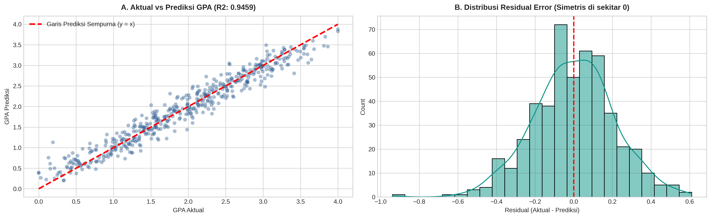
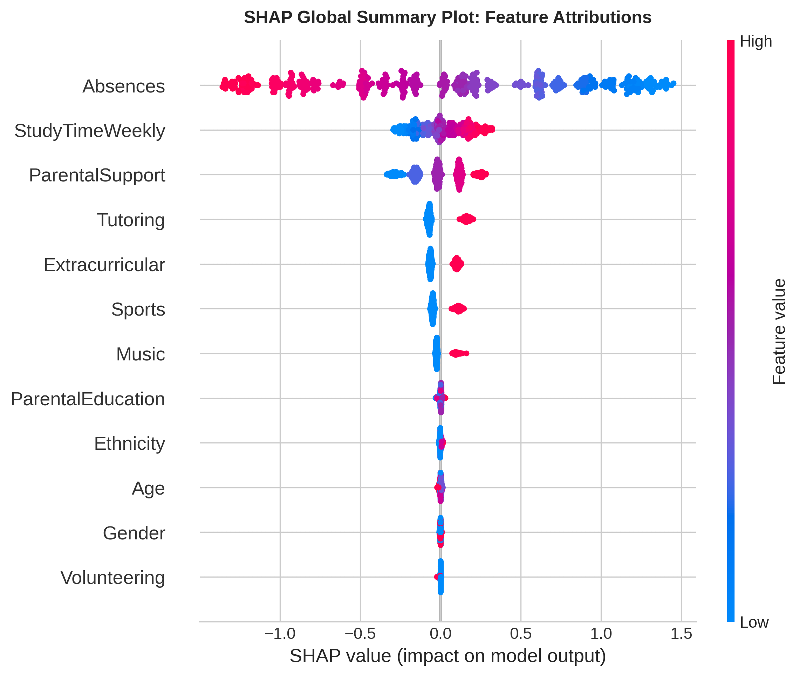

# Student Performance Predictor & Explainable AI
### Multivariate Tabular Modeling & Actionable Educational Intervention Framework

[](https://www.python.org/)
[](https://scikit-learn.org/)
[](https://xgboost.readthedocs.io/)
[](https://shap.readthedocs.io/)
[](https://streamlit.io/)
[](LICENSE)

An institutional machine learning system designed to predict high school student academic performance (GPA) and power early-warning retention systems. Built with strict **target leakage prevention**, rigorous 5-fold cross-validation benchmarking, and **Explainable AI (SHAP)** to provide educators and counselors with transparent, actionable intervention recommendations.

---

## 📌 Problem Formulation & Educational Analytics Context

Academic difficulties often remain unnoticed until end-of-term examinations, when it is too late to reverse course failure. Building an early warning system enables educational institutions to:
1. **Forecast Academic Outcomes:** Predict student cumulative Grade Point Average (GPA on a 0.0 to 4.0 scale) from behavioral, lifestyle, and parental factors.
2. **Prevent 100% Target Leakage:** In educational datasets with both continuous `GPA` and categorical `GradeClass` (A through F), using `GradeClass` to predict `GPA` (or vice-versa) is a classic target leakage trap. This pipeline isolates purely behavioral and habit features (`Absences`, `StudyTimeWeekly`, `ParentalSupport`, `Tutoring`, etc.) and drops all post-facto academic indicators.
3. **Prescribe Actionable Interventions:** Rather than serving as an opaque black box, the model provides **Shapley Additive Explanations (SHAP)** to reveal exactly *why* a student is at risk, enabling counselors to answer: *"What if this student cuts absences by 5 days and enters tutoring?"*

---

## 🏗️ Pipeline Architecture (Zero-Leakage Design)

```
Student Cohort Records (2,392 High School Students)
          │
          ├── Drop Identifiers & Post-Hoc Targets (StudentID, GradeClass)
          │
          ├── Stratified 80:20 Train-Test Split (Preserving Target Distribution)
          │     ├── Train Partition (1,913 students)
          │     └── Holdout Test Partition (479 students)
          │
          ├── 5-Fold Cross-Validation Benchmarking:
          │     ├── Linear / Ridge Regression
          │     ├── Decision Tree Regressor
          │     ├── Random Forest Regressor
          │     └── Gradient Boosting (XGBoost Regressor)
          │
          └── Champion Model Evaluation & Explainable AI (SHAP):
                ├── Holdout Test Benchmark (R² = 94.6%, MAE = 0.1666 GPA)
                ├── SHAP Global Feature Attribution (Beeswarm Summary)
                ├── Algorithmic Fairness Audit (Demographic Parity)
                └── Interactive What-If Intervention Simulator
```

---

## 📊 5-Fold Cross-Validation Leaderboard

Models were evaluated across 5 folds on the 1,913-student training set using **$R^2$ Score**, **RMSE**, and **MAE**:

| Model Strategy | Mean $R^2$ Score | Std $R^2$ | Mean RMSE | Mean MAE | Training Time | Status |
| :--- | :---: | :---: | :---: | :---: | :---: | :---: |
| **1. Baseline (Ridge Regression)** | **0.9535** | ± 0.0030 | **0.1975** | **0.1602** | 4.97 s | Strong Linear Baseline |
| **4. Gradient Boosting (XGBoost)** | **0.9476** | ± 0.0025 | **0.2095** | **0.1680** | **0.33 s** | **Champion XAI Model** 🥇 |
| **3. Random Forest Regressor** | 0.9162 | ± 0.0059 | 0.2648 | 0.2143 | 2.54 s | Tree Ensemble |
| **2. Decision Tree Regressor** | 0.8715 | ± 0.0086 | 0.3279 | 0.2650 | 0.19 s | Single Tree Baseline |

> **Model Selection Decision:** While Ridge Regression performed very well due to the strong linear relationship between absences and GPA, **Gradient Boosting (XGBoost)** was chosen as the production champion because it seamlessly integrates with **TreeSHAP** for exact, non-linear feature attribution and interactive what-if simulation.

---

## 🎯 Holdout Test Evaluation (479 Students)

On the untouched holdout test partition:
- **$R^2$ Score:** **`0.9459`** (94.6% of GPA variance explained)
- **Root Mean Squared Error (RMSE):** **`0.2115`** GPA points
- **Mean Absolute Error (MAE):** **`0.1666`** GPA points (average prediction deviation is under $\pm 0.17$ on a 4.0 scale)



---

## 🧠 Explainable AI (XAI) & SHAP Analysis



### Key Insights from SHAP Global Attribution:
1. **Absences is the Dominant Factor:** High absenteeism (red dots) drives predicted GPA downward by up to **-1.3 points**, while near-zero absences (blue dots) provides an uplift of up to **+1.4 points**.
2. **Habitual & Parental Catalysts:** Regular study time (`StudyTimeWeekly`) and strong parental involvement (`ParentalSupport`) consistently provide positive GPA boosts of **+0.20 to +0.35 points**.
3. **Tutoring Efficacy:** Participating in tutoring sessions systematically adds a positive uplift across all baseline grade levels.
4. **Algorithmic Fairness (Zero Demographic Bias):** Demographics including `Age`, `Gender`, and `Ethnicity` have SHAP values clustered tightly at **0.0**, proving that the model evaluates students purely on observable learning habits and attendance, without demographic bias.

---

## 💻 Streamlit Web Application Features

The interactive web application (`app.py`) serves as a comprehensive academic advisor workstation:

1. **Individual Student Predictor & What-If Simulator:**
   - Real-time GPA estimation and letter grade classification (A, B, C, D, F).
   - Dynamic **What-If Intervention Simulator**: Test how reducing absences by $N$ days and adding $H$ hours of study time changes the student's predicted GPA and moves them out of the at-risk category.
   - Built-in one-click profiles: Star Student, Average Student, and At-Risk Student.
2. **Cohort Screening & Early Warning Roster:**
   - Upload student cohorts (CSV) or inspect the pre-loaded 479-student holdout test cohort.
   - Summary KPI cards: Total Enrolled, High Distinction (A), Satisfactory (B/C), and At-Risk (GPA < 2.0).
   - Filterable student roster with exportable intervention reports.
3. **Explainable AI Research Hub:**
   - Interactive visualizations of SHAP summary distributions and model methodology documentation.

---

## 📁 Repository Structure

```
student-performance-predictor/
├── app.py                                # Interactive Streamlit Academic Dashboard
├── requirements.txt                      # Project dependencies (pinned numpy < 2)
├── README.md                             # Comprehensive engineering documentation
├── .gitignore                            # Git exclusion rules
├── student_performance_artifacts/
│   ├── student_model.joblib              # Trained XGBoost Regressor Pipeline
│   ├── metadata.json                     # Hyperparameters & evaluation metrics
│   ├── test_students_sample.csv          # Holdout test cohort with predictions (479 rows)
│   ├── actual_vs_predicted.png           # Actual vs Predicted evaluation plot
│   └── shap_summary.png                  # SHAP Beeswarm summary plot
├── notebooks/
│   └── 05_student_performance_prediction.ipynb # Complete reproducible research notebook
└── reports/
    └── figures/
        ├── actual_vs_predicted.png
        └── shap_summary.png
```

---

## 🚀 Quickstart & Local Installation

### 1. Clone Repository & Setup Virtual Environment
```bash
git clone https://github.com/rafikamindra98/student-performance-predictor.git
cd student-performance-predictor

python3 -m venv .venv
source .venv/bin/activate
```

### 2. Install Dependencies
```bash
pip install -r requirements.txt
```

### 3. Launch Streamlit Application
```bash
streamlit run app.py
```
Open your browser at `http://localhost:8501`.

---

## 👤 Author
**Rafi Kamindra**  
- GitHub: [@rafikamindra98](https://github.com/rafikamindra98)  
- Portfolio Series: Project 5 of 5 (End-to-End Machine Learning Roadmap)
